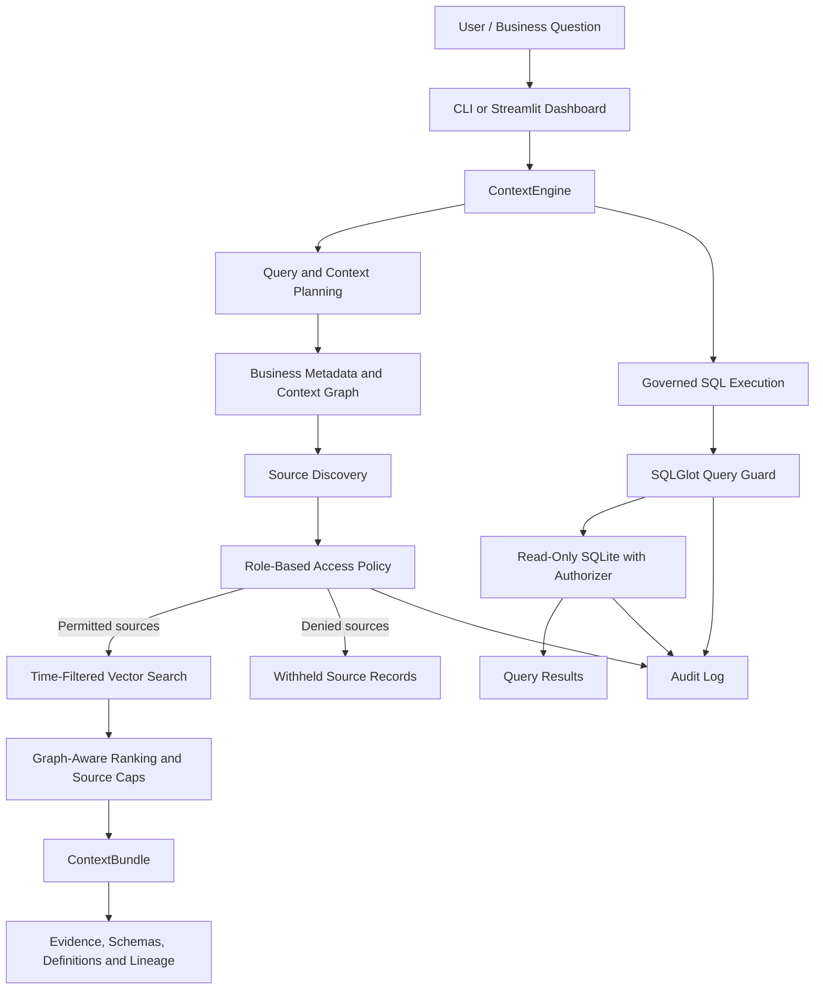

# ContextIQ — Governed Business Context & Retrieval Platform

ContextIQ is a Python-based governed retrieval prototype that helps business applications retrieve relevant information while respecting role-based access policies, business metadata, data lineage and source-level permissions.

Instead of relying on unrestricted vector search, ContextIQ combines a context graph, metadata-aware retrieval, access control and SQL validation to produce structured, permission-aware business context.

**Current status:** Working prototype with synthetic business data, CLI, Streamlit dashboard, governed graph-based retrieval, plain RAG baseline, governed SQL execution and audit logging.

**Test status:** 122 automated tests passing (`pytest -q`).

## Features

- **Governed graph-based retrieval:** Uses business metadata and context relationships to identify relevant sources.
- **Role-based access control:** Supports four roles with different evidence permissions.
- **Context graph:** Connects business terms, authoritative tables, upstream data and related documents.
- **Temporal filtering:** Resolves business time references such as "last month".
- **Metadata-aware retrieval:** Uses source-specific vector search, filtering, scoring and ranking.
- **Deprecated-source handling:** Excludes deprecated sources from governed retrieval.
- **Governed SQL execution:** Validates SQL queries against table and column permissions.
- **Audit logging:** Records governance and query activity.
- **Streamlit dashboard:** Allows users to select a role, submit business questions and inspect retrieved evidence, schemas and lineage.
- **Plain RAG baseline:** Provides an unrestricted retrieval comparison path for experimentation.

## Architecture



## Technology stack

| Technology | Purpose |
|---|---|
| Python | Core application and retrieval logic |
| ChromaDB | Vector storage and retrieval |
| NetworkX | Context graph |
| SQLGlot | SQL parsing and validation |
| SQLite | Synthetic business data and governed SQL execution |
| Streamlit | Interactive dashboard |
| PyYAML | Metadata configuration |
| Pytest | Automated testing |
| Sentence Transformers | Optional semantic embeddings |

## Project structure

```text
ContextIQ/
│
├── app.py
├── contextiq/
│   ├── context/
│   │   ├── ingest.py
│   │   ├── embedders.py
│   │   ├── graph.py
│   │   └── store.py
│   │
│   ├── retrieval/
│   │   ├── graph_rag.py
│   │   ├── plain_rag.py
│   │   └── ...
│   │
│   ├── governance/
│   │   ├── policy.py
│   │   ├── sql_guard.py
│   │   ├── executor.py
│   │   └── audit.py
│   │
│   ├── synth/
│   ├── engine.py
│   └── ...
│
├── data/
│   ├── context/
│   └── generated/
│
├── tests/
├── requirements.txt
├── pytest.ini
├── .env.example
└── README.md
```

## Getting started

### 1. Clone the repository

```bash
git clone https://github.com/RachanaC03/ContextIQ.git
cd ContextIQ
```

### 2. Create and activate a virtual environment

**Windows CMD:**

```cmd
python -m venv .venv
.venv\Scripts\activate
```

**macOS / Linux:**

```bash
python -m venv .venv
source .venv/bin/activate
```

### 3. Install dependencies

```bash
pip install -r requirements.txt
```

### 4. Generate synthetic business data

```bash
python -m contextiq generate
```

This generates synthetic tables, business documents and ground-truth data.

### 5. Build the retrieval index

```bash
python -m contextiq index
```

This processes documents, creates chunks and indexes them in ChromaDB.

### 6. Run automated tests

```bash
pytest -q
```

**Latest verified result:** 122 passed.

### 7. Run the Streamlit dashboard

```bash
streamlit run app.py
```

Open `http://localhost:8501` in your browser.

## Using ContextIQ

### Supported roles

| Role | Intended access |
|---|---|
| `support_analyst` | Customer complaints and support information |
| `quality_engineer` | Product quality and incident information |
| `finance_manager` | Financial and business information |
| `executive` | Executive-level business information |

Role policies are configured in `data/context/roles.yaml`.

### Governed retrieval

Example question:

```text
Why did customer complaints increase last month,
which products were affected, and what should we do?
```

Run the query with different roles:

```cmd
python -m contextiq ask "Why did customer complaints increase last month, which products were affected, and what should we do?" --role support_analyst
```

```cmd
python -m contextiq ask "Why did customer complaints increase last month, which products were affected, and what should we do?" --role finance_manager
```

The governed retrieval path applies source permissions before returning evidence.

### Plain RAG baseline

```cmd
python -m contextiq ask "Why did customer complaints increase last month, which products were affected, and what should we do?" --plain --role finance_manager
```

This provides an unrestricted baseline for comparing retrieval behavior. It is intended for controlled experimentation, not as a secure alternative to governed retrieval.

### Inspect the grounded context

```cmd
python -m contextiq ask "Why did customer complaints increase last month, which products were affected, and what should we do?" --role support_analyst --prompt
```

This displays the structured context that could be supplied to a language model. The current prototype retrieves context; it does not yet generate complete LLM-based business answers.

## Governed SQL

ContextIQ includes a SQL validation and execution path.

Example permitted query:

```cmd
python -m contextiq sql "SELECT product_id, complaint_rate_pct FROM complaints_monthly WHERE month='2026-10' ORDER BY 2 DESC" --role support_analyst
```

Example restricted query:

```cmd
python -m contextiq sql "SELECT unit_price FROM orders" --role support_analyst
```

The SQL path includes:

1. SQL parsing and validation using SQLGlot.
2. Single-SELECT query restrictions.
3. Table and column permission checks.
4. Read-only SQLite execution.
5. A SQLite authorizer as an additional enforcement layer.

Inspect audit information:

```cmd
python -m contextiq audit
```

## Synthetic business scenario

ContextIQ uses a fictional appliance company called **Hearthline**.

The generated dataset contains:

- 20,000 synthetic orders.
- 380 synthetic complaints.
- 57 business documents.
- Eight products.
- Four information access tiers: general, support, quality and finance.
- Business metadata, lineage information and ground-truth data.

The dataset includes deliberately planted scenarios:

- **P-104 AeroBrew Pro:** A faulty heating element associated with production batch `B-2026-09B` leads to an increase in October complaints.
- **P-107 Robo Vac R2:** A carrier change contributes to delivery-delay complaints.
- **Deprecated data source:** `legacy_complaint_stats` contains stale information and a different metric definition.

These scenarios provide test cases for product discovery, temporal retrieval, source selection and deprecated-source handling.

All business data is synthetic; no real customer information is used.

## Design decisions

- Enforce access policies in application logic rather than relying only on prompt instructions.
- Check permissions at the source level before retrieving evidence.
- Use business metadata and graph relationships to guide source discovery.
- Exclude deprecated sources from governed retrieval.
- Apply time filters and per-source retrieval limits to reduce irrelevant or repetitive evidence.
- Apply SQL validation and database-level authorization as separate enforcement layers.
- Maintain a plain RAG baseline to compare retrieval behavior against the governed approach.

## Current limitations

- This is a retrieval prototype, not a complete autonomous AI agent.
- No LLM-based answer generation or agent orchestration is currently implemented.
- The default hashing embedder is a deterministic fallback and is largely lexical in behavior.
- The Sentence Transformers MiniLM embedding path is implemented but has not yet been fully validated in this environment.
- Business-term linking currently relies on glossary terms and synonyms.
- SQLite is supported; PostgreSQL integration is not implemented.
- Evaluation with a larger benchmark, RAGAS and custom faithfulness/citation metrics remains future work.
- The prototype has not been deployed as a production service or independently security-audited.

### Embedding configuration

The default `EMBEDDER=auto` setting attempts to use Sentence Transformers and falls back to the hashing embedder when unavailable.

To use the hashing embedder explicitly:

**Windows CMD:**

```cmd
set EMBEDDER=hash
```

To try the Sentence Transformers model:

```cmd
pip install sentence-transformers
set EMBEDDER=st
python -m contextiq index
```

After testing, return to automatic selection with:

```cmd
set EMBEDDER=auto
```

These environment variables apply to the current CMD session.

## Roadmap

| Stage | Planned work |
|---|---|
| Current | Synthetic data, context graph, governed retrieval, SQL guard, audit logging, CLI, Streamlit dashboard and automated tests |
| Next | LLM integration, structured answer generation and LangGraph-based agent workflows |
| Future | FastAPI service, approval workflows and structured citations |
| Future | Retrieval evaluation, tracing, faithfulness and citation-accuracy benchmarks |
| Future | Optional MCP integration, deployment and demonstration video |

## Author

**Rachana C.**

B.Tech — Artificial Intelligence and Machine Learning

Interested in Python, Artificial Intelligence, Machine Learning, NLP and Generative AI.

GitHub: https://github.com/RachanaC03

---

*ContextIQ is an independently developed portfolio project exploring governed retrieval, context engineering and access-aware business intelligence.*